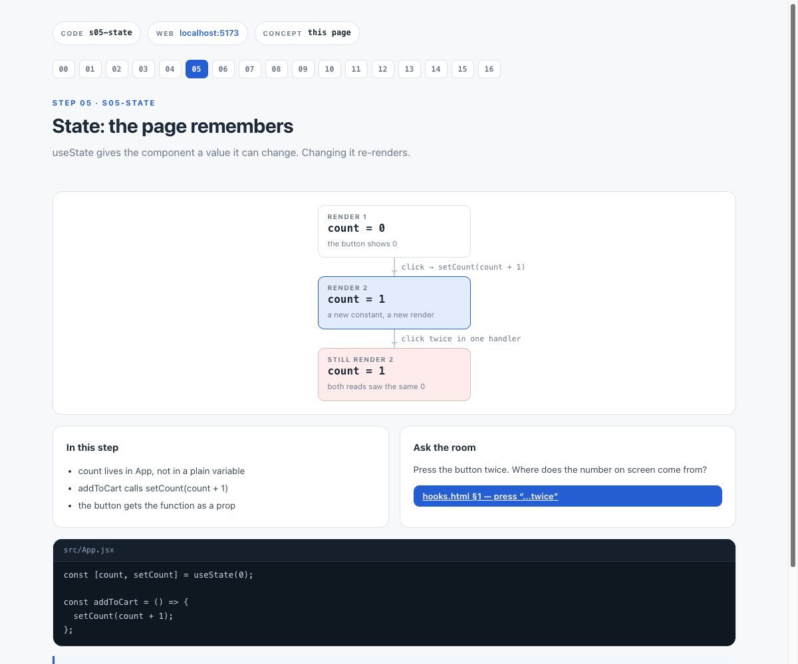

# START HERE

The course is three zones, and one command moves all of them.

| Zone | Where | What it is for |
|---|---|---|
| **CODE** | VS Code, this folder | the branch you are on |
| **WEB** | `http://localhost:5173` | the running app |
| **CONCEPT** | `http://localhost:5173/concepts/step.html` | the explanation for the current step |



The concept tab reads the git branch from the dev server every second. So
`npm run step 5` changes the code **and** the explanation. No reload, no tab juggling.

---

## One-time setup

Two terminals, one browser window, two tabs.

```bash
# terminal 1 — the API
npm run server

# terminal 2 — the app
npm run dev
```

Then open:

1. `http://localhost:5173` — the app
2. `http://localhost:5173/concepts/step.html` — the concept

The first `npm run step` opens tab 2 for you. After that it stays put and follows along.

---

## The loop you repeat 17 times

```bash
npm run step 5
```

1. git checks out `s05-state`
2. the app reloads (Vite)
3. the concept tab updates within a second
4. you read the line on the concept tab, ask its question, and press its button if there is one

Nothing else. No slides, no separate notes to keep in sync.

---

## The eight-minute dry run

Do this once before the session.

| Do | You should see |
|---|---|
| `npm run step 2` | three identical cards, copied by hand |
| `npm run step 3` | the same three, from `map` |
| `npm run step 5` | Add works; the cart count goes up |
| `npm run step 10`, then type `mug` fast | the wrong results win |
| `npm run step 11`, same typing | the right results win |
| `npm run step 14` | the cart still works, but `App.jsx` is short |
| `npm run step 15` | the same app, now in folders |

If those seven behave, you can teach it.

---

## What you say, per step

The concept tab holds the short version:

- a one-line idea
- three bullets: what changed
- one code snippet
- **one question for the room**

Ask the question, wait three seconds, then answer it yourself. That silence is
where the learning happens; do not fill it.

The longer version, with timings and the exact words, is `docs/run-sheet.md`.

---

## Where the deep illustrations live

The step page is the spine. Three pages go deeper, and each step links to the right
one at the right moment:

| Page | Open it when |
|---|---|
| `concepts/hooks.html` | step 5 (why two `setState` calls add one) and step 11/13 (when effects run) |
| `concepts/api.html` | step 9 (loading, 500, offline) and step 10 (the race) |
| `concepts/context.html` | step 14 (before/after App, what re-renders) |

They are linked from the button on the step page, so you do not have to remember.

---

## The three things that can go wrong

| Symptom | Fix |
|---|---|
| Concept tab says "Start the dev server" | `npm run dev` is not running |
| The app shows "Loading..." forever | `npm run server` is not running (terminal 1) |
| `npm run step` says no branch | you are not in this folder: `cd ~/Desktop/comp1682/react-crash-course` |
| The concept tab did not open | `npm run concept` |

---

## The one sentence

> **Move the step, and all three zones move with it: the code in VS Code, the app in
> the browser, and the explanation on the concept tab. Your job is to read the line,
> ask the question, and let them look.**
