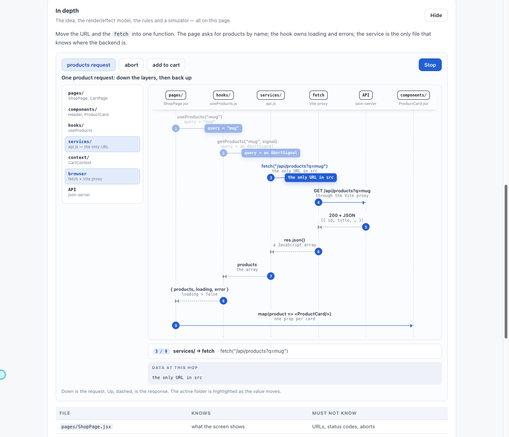

# START HERE

The course is three zones, and one command moves all of them.

| Zone | Where | What it is for |
|---|---|---|
| **CODE** | VS Code, this folder | the branch you are on |
| **WEB** | `http://localhost:5173` | the running app |
| **CONCEPT** | `http://localhost:5173/concepts/step.html` | the explanation for the current step |



The concept tab reads the git branch from the dev server every second. So
`npm run step 5` changes the code **and** the explanation. No reload, no tab juggling.

---

## One-time setup

Two terminals, one browser window, two tabs.

```bash
# terminal 1 — the API
npm run server

# terminal 2 — the app
npm run dev
```

Then open:

1. `http://localhost:5173` — the app
2. `http://localhost:5173/concepts/step.html` — the concept

The first `npm run step` opens tab 2 for you. After that it stays put and follows along.

---

## The loop you repeat 17 times

```bash
npm run step 5
```

1. git checks out `s05-state`
2. the app reloads (Vite)
3. the concept tab updates within a second
4. you read the line, ask its question, then work through **In depth** and the diff

Nothing else. No slides, no separate notes to keep in sync, no second page to open.

### The second pass: the diff

Every step page has an open **“What changed since the last step”** card, right under
the diagram. It is the real `git diff`, split into before / after columns with line
numbers — the command is printed under the summary.

Do this **after** the diagram, before you move on:

1. read the summary out loud: *“four files changed, twenty-seven insertions, nine deletions”*
2. point at one red line on the left and the green line beside it
3. say the line: **the diagram explains it, the diff proves it**

If you would rather type it in the terminal, the exact command is on the card:
`git diff s15-folders s16-router -- src`.

---

## The eight-minute dry run

Do this once before the session.

| Do | You should see |
|---|---|
| `npm run step 2` | three identical cards, copied by hand |
| `npm run step 3` | the same three, from `map`; **In depth** key/index simulator |
| `npm run step 4` | **In depth** pass product 1 into ProductCard; **try to edit** is blocked |
| `npm run step 5` | Add works; **In depth** “twice” shows +1, functional shows +2 |
| `npm run step 9` | **Play** the folder-layer request: `pages/ → hooks/ → services/ → fetch → API`, then the response back up |
| `npm run step 10`, then type `mug` fast | the wrong results win |
| `npm run step 11`, same typing | the **abort** tab shows cleanup stopping the old request at the layer boundary |
| `npm run step 14` | the provider wraps App; **add to cart** sends the action up and the value down to Header/ShopPage/CartPage |
| `npm run step 16` | the router wraps App; **go to /cart** mounts CartPage and unmounts ShopPage; refresh and back work |
| `npm run step 15` | the same app, now in folders |

If those seven behave, you can teach it.

---

## What you say, per step

The concept tab holds the short version:

- a one-line idea
- three bullets: what changed
- one code snippet
- **one question for the room**

Ask the question, wait three seconds, then answer it yourself. That silence is
where the learning happens; do not fill it.

The longer version, with timings and the exact words, is `docs/run-sheet.md`.

---

## Where the deep illustrations live

The step page is the spine. Three pages go deeper, and each step links to the right
one at the right moment:

Every step has an **In depth** section with the relevant figures, tables and a simulator.
The old pages are still there as optional deep dives, but you do not need them:

| Page | Also embedded at |
|---|---|
| `concepts/hooks.html` | steps 5 (snapshot, batching) and 9 (dependency timeline) |
| `concepts/api.html` | step 9 (folder-layer request) and step 11 (race, abort) |
| `concepts/context.html` | step 14 (wrapping provider tree, before/after App) |

The early steps also carry the **component tree**: one card inside App, then three cards,
then `ProductCard × 3`, then Header + pages. That is the component mindset before the
word “component” has to be defined.

---

## The three things that can go wrong

| Symptom | Fix |
|---|---|
| Concept tab says "Start the dev server" | `npm run dev` is not running |
| The app shows "Loading..." forever | `npm run server` is not running (terminal 1) |
| `npm run step` says no branch | you are not in this folder: `cd ~/Desktop/comp1682/react-crash-course` |
| The concept tab did not open | `npm run concept` |

---

## The one sentence

> **Move the step, and all three zones move with it: the code in VS Code, the app in
> the browser, and the explanation on the concept tab. Your job is to read the line,
> ask the question, and let them look.**
