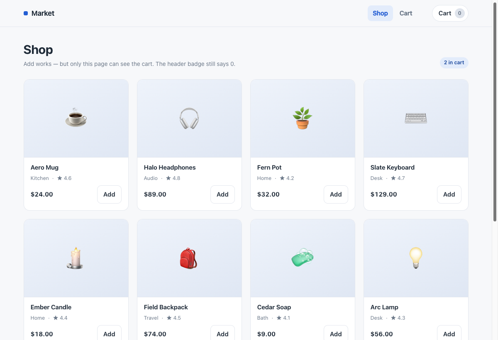
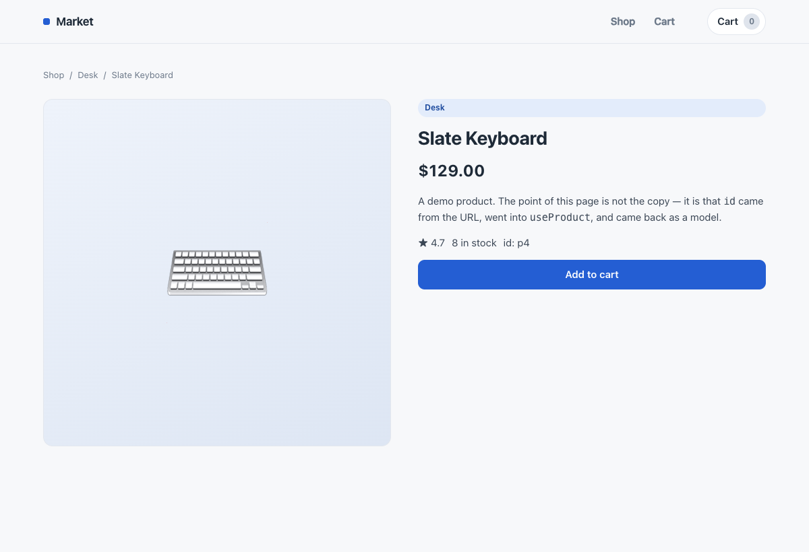
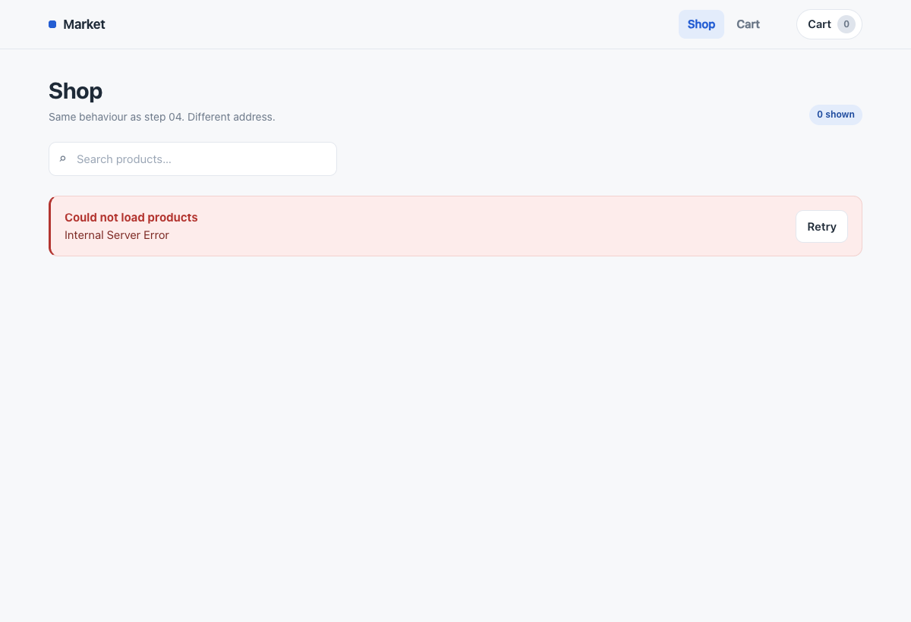
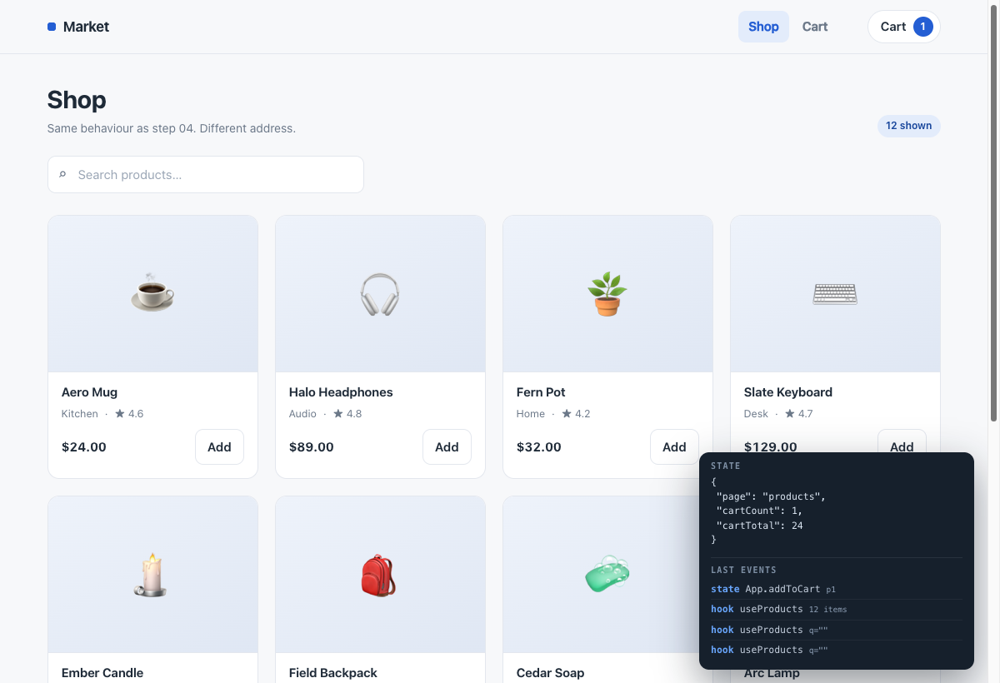
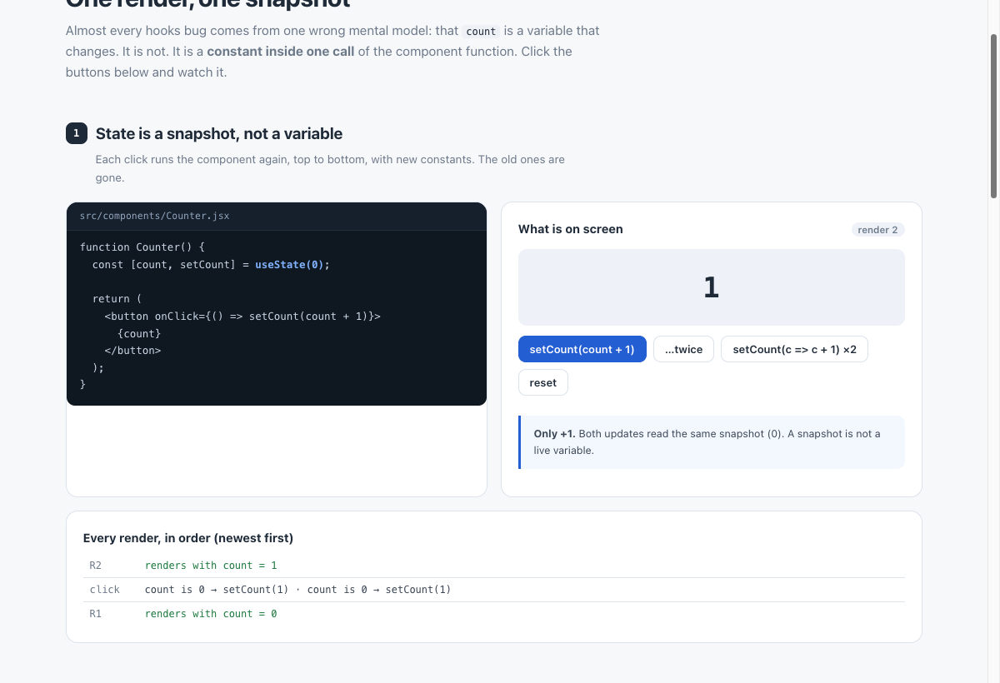
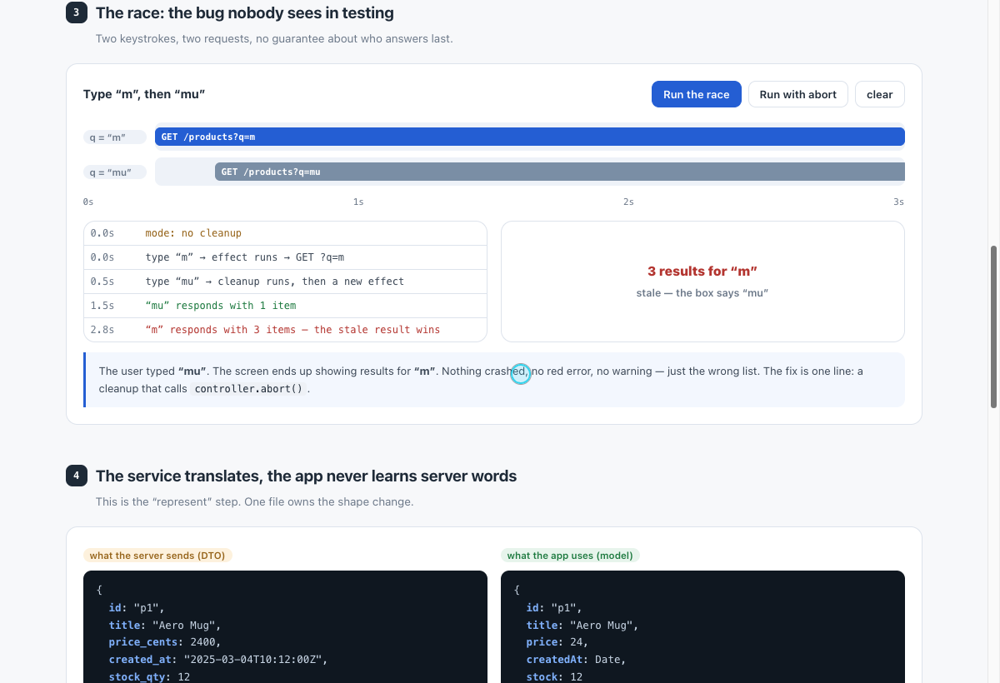
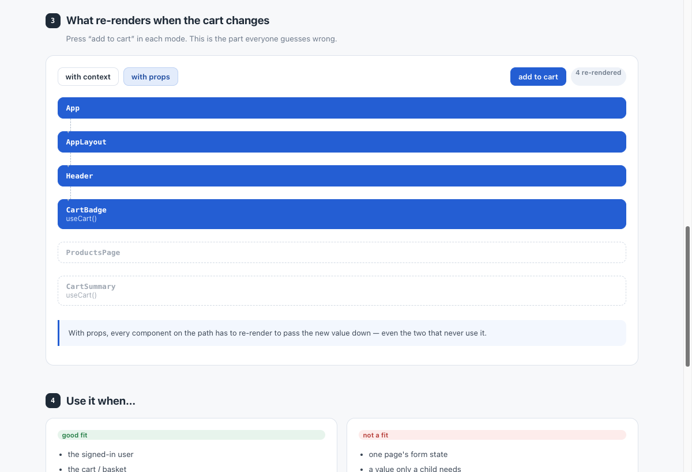

# START HERE

You have four things:

1. **an app** that exists in nine versions, one per git branch
2. **three concept pages** that you press buttons on, in front of the room
3. **a run sheet** with the words to say (`docs/run-sheet.md`)
4. **a handout** students keep (`HANDOUT.md`)

This file is the five-minute dry run. Do it once, on your own, before the session.
Everything below is copy-paste.

---

## 0. Open three windows

| Window | What goes in it |
|---|---|
| Terminal | this folder, `~/Desktop/comp1682/react-crash-course` |
| Browser tab 1 | `http://localhost:5173` |
| Browser tab 2 | `concepts/index.html` (open from Finder, or `concepts/index.html` in the repo) |

On the projector you will switch between those two tabs and VS Code. Nothing else.

---

## 1. Start the app

```bash
cd ~/Desktop/comp1682/react-crash-course
npm run dev
```

You should see:

```
  VITE v8  ready in 200 ms
  ➜  Local:   http://localhost:5173/
```

Leave that terminal running for the whole session. **Do not restart it** when you
change branches — Vite reloads by itself.

If the browser says "This site can't be reached", the terminal is not running.

---

## 2. Move between the nine versions

```bash
npm run step        # list them
npm run step 2      # → 02-state
npm run step 6      # → 06-custom-hook
```

That is the whole interface. `npm run step 6` is exactly `git checkout 06-custom-hook`,
but you do not have to remember the names. It works from any branch.

What you should see after `npm run step 2`:



Two things to notice in that picture, because they are the lesson of step 02:

- the badge in the header says **0**
- the page says **2 in cart**

Same data, two places, and only one of them updates. That is the bug the next two
hours fix. Say it out loud when you show it.

---

## 3. The five things you will actually do on stage

### a. Show a working step

`npm run step 8`, then click a product. The URL changes to `/products/p4`.



### b. Show the failure, on purpose

Go to `http://localhost:5173/?chaos=fail`.



Say: *"This is what a 500 is supposed to look like. It is a screen, not a blank page."*

### c. Show the dataflow

`npm run step 6`, then open `http://localhost:5173/?debug=1` and click **Add**.



The panel is the only reason `logEvent` exists. You point at it instead of explaining.

### d. Press the concept pages

Tab 2. Each page has buttons; the numbers below are what should appear.

**Hooks** — `concepts/hooks.html`

| Press | You should see |
|---|---|
| **…twice** | screen shows `1`, and the verdict says *Only +1* |
| **setCount(c => c + 1) ×2** | `+2` |
| mode **[]** then *type in search* | *nothing happens (deps unchanged)* |
| mode **[query]** then *type in search* | *cleanup() runs* then *effect runs* |
| *unmount* | *cleanup() runs on unmount* |



**API** — `concepts/api.html`, section 3, press **Run the race**.



Then press **Run with abort** and watch the “m” bar stop and turn red.

**Context** — `concepts/context.html`, section 3, press **add to cart**.



Switch to **with context**, press again: **2 re-rendered**. Ask the room to predict
before you click. This is the moment they get it.

### e. Show the diff

```bash
git diff 04 05 -- src/pages/ProductsPage.jsx
git diff 05 06 --stat
```

Red means detail moved down a layer. That is the whole argument of the course.

---

## 4. What "a step" looks like on screen

When you check out a branch, the app changes but the *shape* does not. Use this to
know where you are:

| You see | You are on |
|---|---|
| nothing, just "Market" | `00-start` |
| a grid of products, Add does nothing | `01-static-ui` |
| count on the page, header still 0 | `02-state` |
| a working cart page and a search box | `03-forms-lifting` |
| a spinner, then products, but a wrong result if you type fast | `04-fetch-in-component` |
| same, plus `?chaos=fail` works | `05-http-service` |
| plus `?debug=1` shows a panel | `06-custom-hook` |
| header badge updates from anywhere | `07-context` |
| product titles are links, URL changes | `08-router` |

---

## 5. The ten-minute prep if you have no time

1. `npm run dev`
2. `npm run step 4`, open `/?chaos=slow=2`, type `mu` fast. See the wrong list.
3. `npm run step 6`, do it again. It is correct.
4. Open `concepts/context.html`, press the two buttons in section 3.
5. Read the first page of `docs/run-sheet.md`.

That is enough to teach the spine. Everything else is decoration.

---

## 6. If something breaks

| Symptom | Fix |
|---|---|
| "This site can't be reached" | the dev server is not running: `npm run dev` |
| The page is blank after switching branches | refresh the browser (Vite sometimes needs one reload after a checkout) |
| `npm run step` says no such branch | you are not in the repo folder. `cd ~/Desktop/comp1682/react-crash-course` |
| Cart shows odd quantities | the fake server keeps the cart in localStorage. Clear it: DevTools → Application → Local Storage → delete `market.cart.v1` |
| A concept page looks broken | they need no server; open `concepts/index.html` straight from Finder |
| You want a clean slate | `git checkout main && git status` should be empty |

---

## 7. The one sentence to remember

If you forget everything else on this page:

> **Check out a branch, open the browser, press the buttons on the concept pages,
> and show the diff.** The code is already written; your job is to point at it.

The run sheet (`docs/run-sheet.md`) has the minute-by-minute script and the exact
words. Read it once before you start, and keep it open on a second screen.
